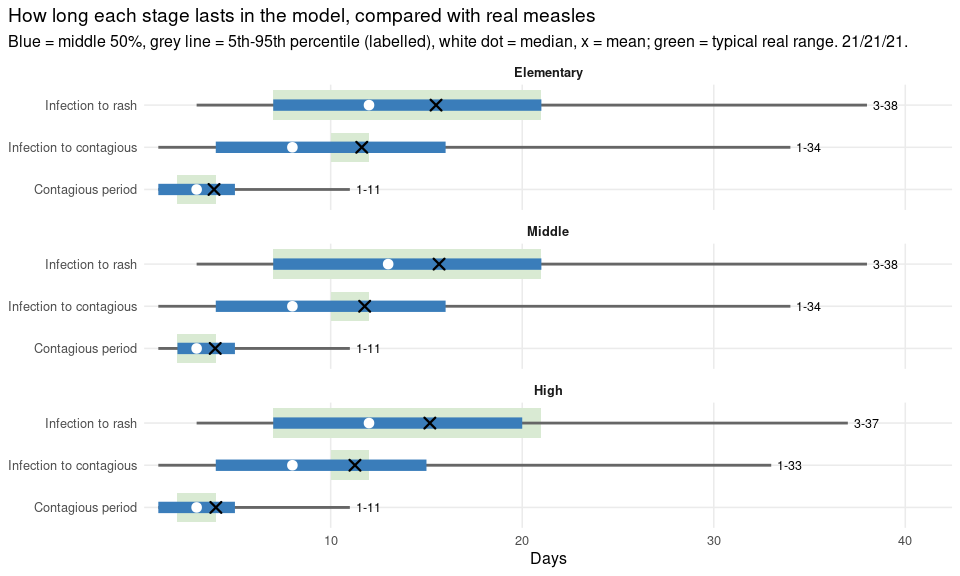
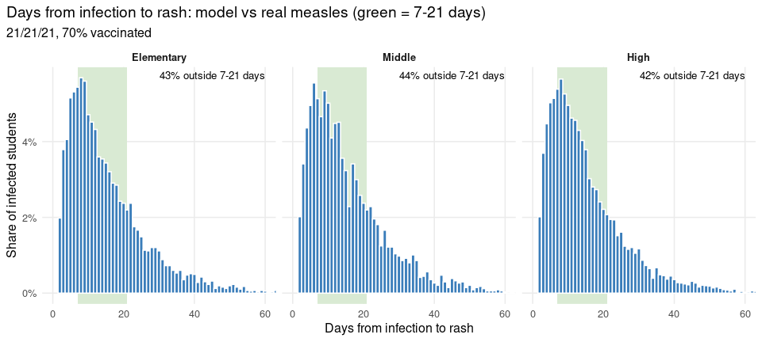
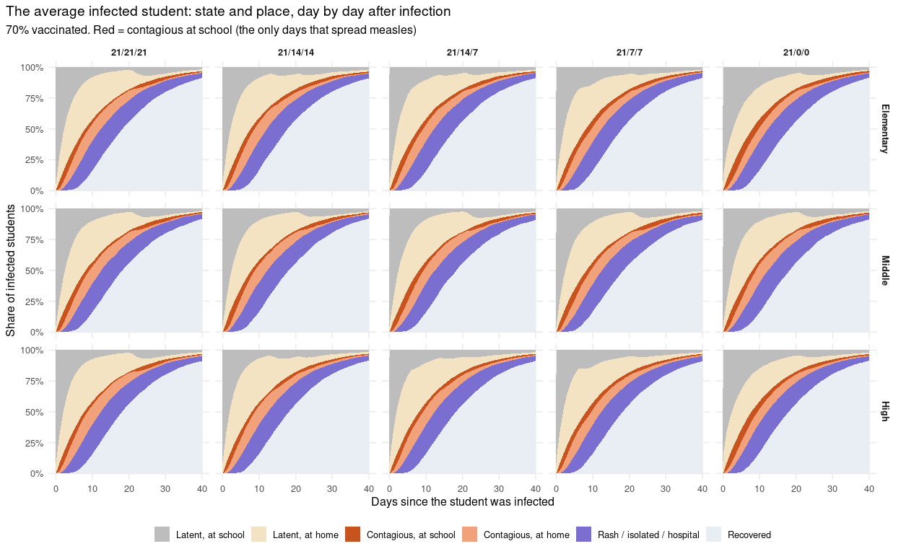
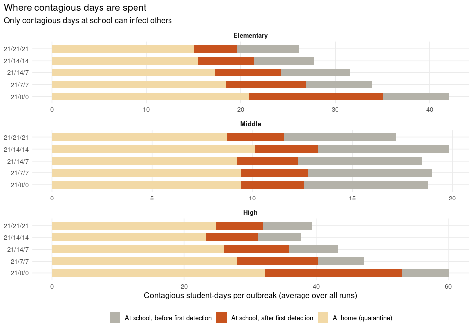
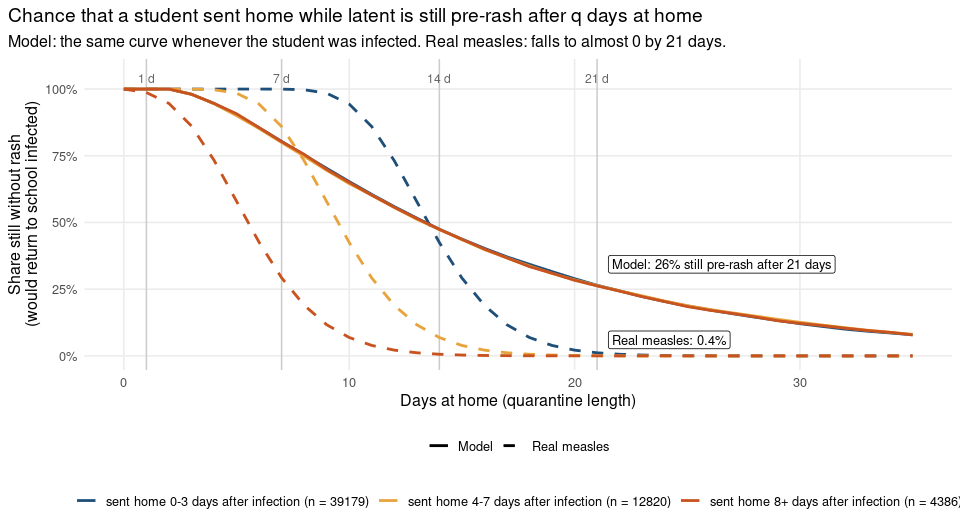
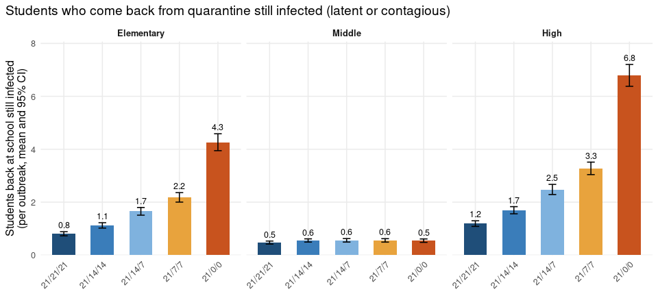
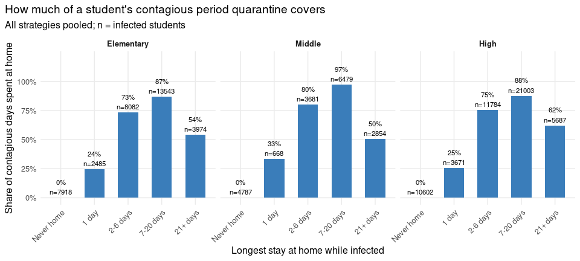

# 9. How the model behaves: disease progression, quarantine and where
infections come from

- [What this document shows](#what-this-document-shows)
- [T1. Disease progression in the
  model](#t1.-disease-progression-in-the-model)
- [C0. Stage lengths compared with real
  measles](#c0.-stage-lengths-compared-with-real-measles)
- [C6. Days from infection to rash](#c6.-days-from-infection-to-rash)
- [C1. The average infected student, day by
  day](#c1.-the-average-infected-student-day-by-day)
- [C2. Where contagious days are
  spent](#c2.-where-contagious-days-are-spent)
- [R1. Will an infected student still be infected when quarantine ends?
  Model vs real
  measles](#r1.-will-an-infected-student-still-be-infected-when-quarantine-ends-model-vs-real-measles)
- [R2. Per outbreak: infected students sent home, and how many came back
  still
  infected](#r2.-per-outbreak-infected-students-sent-home-and-how-many-came-back-still-infected)
- [C4. Students who come back from quarantine still
  infected](#c4.-students-who-come-back-from-quarantine-still-infected)
- [C5. How much of the contagious period quarantine
  covers](#c5.-how-much-of-the-contagious-period-quarantine-covers)

## What this document shows

Every run here has its **own independent seed** (drawn once with
`draw_seeds()` from `measles_model.R`), so runs are never compared one
by one. Everything is a **summary over all runs** of a scenario:

| Exhibit    | Question it answers                                                                                                                               | Where in the paper                               |
|------------|---------------------------------------------------------------------------------------------------------------------------------------------------|--------------------------------------------------|
| T1, C0, C6 | How long is each disease stage in the model, and how does that compare with real measles?                                                         | Methods / Supplement                             |
| C1         | What does the *average* infected student go through, day by day?                                                                                  | Results (model behaviour)                        |
| C2         | Where are contagious days spent: at school or at home?                                                                                            | Results (mechanism)                              |
| R1         | After *q* days at home, what is the chance an infected student has still not had the rash, in the model and in real measles?                      | Methods / Discussion (the key model property)    |
| R2, C4     | Per outbreak: how many infected students are sent home, how many come back still infected, and how many contagious days they then spend at school | Results / Discussion (why the strategies differ) |
| C5         | How much of a student’s contagious period does quarantine cover?                                                                                  | Discussion                                       |

**How to report numbers.**

- *Spread between students* (how variable the disease course is):
  **median (5th95th percentile)**, e.g. “latent period: median 8 days
  (5th95th percentile 134)”.
- *An average over runs* (how precisely it is estimated): **mean (95%
  CI)**, e.g. “students released still infected: 6.6 per outbreak (95%
  CI 6.36.9)”.

> **Note**
>
> Quick test: `N_RUNS=50 quarto render 09_model_behaviour.qmd`.
> Simulations are cached in `results/09_behaviour2_*.rds`; delete them
> to re-run.

Each school × strategy has **1000 independent runs** at **70%**
vaccination coverage, 100 days each. Durations are measured on infected
students other than the first case, and only for students whose stage
ended within the 100 simulated days.

## T1. Disease progression in the model

| School     | Stage                               | Students | Median (days) | 5th-95th percentile |    Mean (95% CI) | Real measles         |
|:-----------|:------------------------------------|---------:|--------------:|--------------------:|-----------------:|:---------------------|
| Elementary | Infection to contagious (latent)    |     5728 |             8 |                1-34 | 11.6 (11.3-11.9) | about 10-12 days     |
| Elementary | Contagious, before rash (prodromal) |     5728 |             3 |                1-11 |    3.9 (3.8-4.0) | about 4 days (2-4)   |
| Elementary | Infection to rash                   |     5648 |            12 |                3-38 | 15.5 (15.2-15.8) | about 14 days (7-21) |
| Elementary | Rash at school to noticed           |     1314 |             1 |                 1-2 |    1.3 (1.3-1.3) | \-                   |
| Middle     | Infection to contagious (latent)    |     3395 |             8 |                1-34 | 11.8 (11.4-12.1) | about 10-12 days     |
| Middle     | Contagious, before rash (prodromal) |     3395 |             3 |                1-11 |    4.0 (3.9-4.1) | about 4 days (2-4)   |
| Middle     | Infection to rash                   |     3371 |            13 |                3-38 | 15.7 (15.3-16.0) | about 14 days (7-21) |
| Middle     | Rash at school to noticed           |      874 |             1 |                 1-2 |    1.3 (1.2-1.3) | \-                   |
| High       | Infection to contagious (latent)    |     8787 |             8 |                1-33 | 11.3 (11.0-11.5) | about 10-12 days     |
| High       | Contagious, before rash (prodromal) |     8787 |             3 |                1-11 |    4.0 (3.9-4.1) | about 4 days (2-4)   |
| High       | Infection to rash                   |     8637 |            12 |                3-37 | 15.2 (14.9-15.4) | about 14 days (7-21) |
| High       | Rash at school to noticed           |     1805 |             1 |                 1-2 |    1.3 (1.2-1.3) | \-                   |

Disease progression in the model (21/21/21, 70% vaccinated). Median and
5th-95th percentile describe how much the course varies between
students; mean (95% CI) is the average and its precision.

**How to write it.** “In the model, the latent period had a median of X
days (5th95th percentile AB), compared with about 1012 days for measles.
Because each stage has a geometric duration (the same chance of moving
on every day), the model produces many very short and some very long
stages.”

## C0. Stage lengths compared with real measles

## C6. Days from infection to rash

## C1. The average infected student, day by day

For every infected student, day 0 is the day of infection. Each colour
is the share of all infected students (all runs) in that state and place
on that day. Only the red band, **contagious at school**, can infect
anyone.

## C2. Where contagious days are spent

| School     | Strategy | At school, before detection | At school, after detection | At home          | Outbreak size    |
|:-----------|:---------|:----------------------------|:---------------------------|:-----------------|:-----------------|
| Elementary | 21/21/21 | 6.5 (6.1-6.9)               | 4.6 (4.1-5.1)              | 15.1 (14.0-16.1) | 6.9 (6.6-7.3)    |
| Elementary | 21/14/14 | 6.4 (6.0-6.8)               | 5.9 (5.3-6.5)              | 15.5 (14.4-16.5) | 7.3 (6.9-7.7)    |
| Elementary | 21/14/7  | 7.3 (6.8-7.7)               | 7.0 (6.3-7.6)              | 17.3 (16.1-18.5) | 8.2 (7.8-8.6)    |
| Elementary | 21/7/7   | 7.0 (6.5-7.4)               | 8.5 (7.7-9.2)              | 18.4 (17.2-19.7) | 9.0 (8.5-9.5)    |
| Elementary | 21/0/0   | 7.0 (6.6-7.4)               | 14.2 (13.1-15.4)           | 20.8 (19.5-22.2) | 11.1 (10.5-11.7) |
| Middle     | 21/21/21 | 5.6 (5.2-5.9)               | 2.9 (2.5-3.2)              | 8.7 (8.0-9.5)    | 4.5 (4.2-4.7)    |
| Middle     | 21/14/14 | 6.6 (6.2-7.0)               | 3.1 (2.7-3.5)              | 10.2 (9.4-10.9)  | 5.0 (4.8-5.3)    |
| Middle     | 21/14/7  | 6.2 (5.8-6.6)               | 3.1 (2.7-3.5)              | 9.2 (8.5-10.0)   | 4.7 (4.5-5.0)    |
| Middle     | 21/7/7   | 6.2 (5.8-6.6)               | 3.4 (2.9-3.8)              | 9.5 (8.7-10.2)   | 4.9 (4.6-5.1)    |
| Middle     | 21/0/0   | 6.2 (5.8-6.6)               | 3.1 (2.7-3.5)              | 9.5 (8.7-10.2)   | 4.8 (4.5-5.1)    |
| High       | 21/21/21 | 7.4 (6.9-7.9)               | 7.1 (6.4-7.8)              | 24.9 (23.2-26.6) | 10.2 (9.7-10.8)  |
| High       | 21/14/14 | 6.5 (6.1-7.0)               | 7.8 (7.0-8.5)              | 23.4 (21.8-24.9) | 10.0 (9.5-10.6)  |
| High       | 21/14/7  | 7.3 (6.8-7.8)               | 9.8 (9.0-10.7)             | 26.1 (24.3-27.8) | 11.5 (10.9-12.1) |
| High       | 21/7/7   | 6.9 (6.5-7.4)               | 12.4 (11.4-13.4)           | 28.0 (26.1-29.8) | 12.7 (12.0-13.4) |
| High       | 21/0/0   | 7.1 (6.7-7.6)               | 20.7 (19.4-22.0)           | 32.3 (30.3-34.2) | 16.4 (15.6-17.2) |

Contagious student-days per outbreak, mean (95% CI).

## R1. Will an infected student still be infected when quarantine ends? Model vs real measles

This is the property of the model that explains most of the results.

For every infected student sent home **while still latent**, we count
the days from their first day at home until their rash. The question is:
after *q* days at home, what share have **still not had the rash**?
Those students would return to school on day *q* still infected, and
become contagious there.

- **Model (solid lines, from the simulations):** each day a latent
  student becomes contagious with the same chance (1/12), so the time
  *still to go* does not depend on how long ago the student was
  infected. Students sent home 03, 47 or 8+ days after infection give
  nearly the same curve.
- **Real measles (dashed lines):** infection to symptoms is log-normal
  (median 12.5 days, dispersion 1.23), with the rash about 3 days later.
  A student infected a while ago is close to the rash, so the time still
  to go *does* depend on when they were infected, and almost no one is
  still pre-rash 21 days after exposure. That is why 21 days is the
  standard quarantine.

|              | Group                                          | 1 days at home | 7 days at home | 14 days at home | 21 days at home |
|:-------------|:-----------------------------------------------|:---------------|:---------------|:----------------|:----------------|
| Model        | sent home 0-3 days after infection (n = 39179) | 100%           | 80%            | 47%             | 26%             |
| Model        | sent home 4-7 days after infection (n = 12820) | 100%           | 80%            | 47%             | 26%             |
| Model        | sent home 8+ days after infection (n = 4386)   | 100%           | 80%            | 47%             | 26%             |
| Real measles | sent home 0-3 days after infection             | 100%           | 100%           | 42%             | 1%              |
| Real measles | sent home 4-7 days after infection             | 100%           | 86%            | 7%              | 0%              |
| Real measles | sent home 8+ days after infection              | 99%            | 29%            | 1%              | 0%              |

Share still without rash after q days at home. Model: 56385 students
sent home while latent, all schools and strategies (n per group in the
Group column). Real measles: calculated, no students.

| School     | Strategy | Sent home 0-3 days after infection | Sent home 4-7 days after infection | Sent home 8+ days after infection | Total |
|:-----------|:---------|-----------------------------------:|-----------------------------------:|----------------------------------:|------:|
| Elementary | 21/21/21 |                               2066 |                                773 |                               318 |  3157 |
| Elementary | 21/14/14 |                               2211 |                                724 |                               270 |  3205 |
| Elementary | 21/14/7  |                               2415 |                                868 |                               311 |  3594 |
| Elementary | 21/7/7   |                               2746 |                                885 |                               379 |  4010 |
| Elementary | 21/0/0   |                               3667 |                               1120 |                               342 |  5129 |
| Middle     | 21/21/21 |                               1182 |                                524 |                               167 |  1873 |
| Middle     | 21/14/14 |                               1379 |                                570 |                               217 |  2166 |
| Middle     | 21/14/7  |                               1252 |                                478 |                               196 |  1926 |
| Middle     | 21/7/7   |                               1224 |                                501 |                               210 |  1935 |
| Middle     | 21/0/0   |                               1254 |                                526 |                               196 |  1976 |
| High       | 21/21/21 |                               3227 |                               1077 |                               309 |  4613 |
| High       | 21/14/14 |                               3220 |                               1041 |                               321 |  4582 |
| High       | 21/14/7  |                               3706 |                               1163 |                               393 |  5262 |
| High       | 21/7/7   |                               3964 |                               1200 |                               363 |  5527 |
| High       | 21/0/0   |                               5666 |                               1370 |                               394 |  7430 |

Students sent home while latent, used in R1 (1000 runs per school x
strategy).

**How to write it.** “Each disease stage in the model has a geometric
duration, so the time an infected student still has to go before the
rash does not depend on how long ago they were infected. After 21 days
at home, X% of students quarantined while latent had still not developed
a rash, compared with under 1% expected for measles. These students
return to school infected, which limits the benefit of longer
quarantines (R2).”

## R2. Per outbreak: infected students sent home, and how many came back still infected

One number per outbreak, and outbreaks are independent runs, so the 95%
CIs are valid.

| School     | Strategy |    Outbreak size | Infected students sent home | … came back still infected | Share came back infected | Their contagious days at school |
|:-----------|:---------|-----------------:|----------------------------:|---------------------------:|-------------------------:|--------------------------------:|
| Elementary | 21/21/21 |    6.9 (6.6-7.3) |               4.6 (4.3-4.9) |              0.8 (0.7-0.9) |                      18% |                   2.2 (2.0-2.5) |
| Elementary | 21/14/14 |    7.3 (6.9-7.7) |               4.8 (4.5-5.1) |              1.1 (1.0-1.2) |                      24% |                   3.0 (2.7-3.3) |
| Elementary | 21/14/7  |    8.2 (7.8-8.6) |               5.5 (5.2-5.8) |              1.7 (1.5-1.8) |                      30% |                   3.8 (3.5-4.2) |
| Elementary | 21/7/7   |    9.0 (8.5-9.5) |               6.2 (5.9-6.6) |              2.2 (2.0-2.4) |                      35% |                   4.9 (4.5-5.4) |
| Elementary | 21/0/0   | 11.1 (10.5-11.7) |               8.1 (7.6-8.5) |              4.3 (3.9-4.6) |                      53% |                  9.8 (9.0-10.6) |
| Middle     | 21/21/21 |    4.5 (4.2-4.7) |               2.6 (2.4-2.8) |              0.5 (0.4-0.5) |                      18% |                   1.4 (1.2-1.6) |
| Middle     | 21/14/14 |    5.0 (4.8-5.3) |               3.0 (2.8-3.2) |              0.6 (0.5-0.6) |                      18% |                   1.6 (1.4-1.8) |
| Middle     | 21/14/7  |    4.7 (4.5-5.0) |               2.8 (2.6-3.0) |              0.6 (0.5-0.6) |                      20% |                   1.6 (1.4-1.8) |
| Middle     | 21/7/7   |    4.9 (4.6-5.1) |               2.8 (2.6-3.0) |              0.6 (0.5-0.6) |                      20% |                   1.7 (1.4-1.9) |
| Middle     | 21/0/0   |    4.8 (4.5-5.1) |               2.8 (2.6-3.0) |              0.5 (0.5-0.6) |                      19% |                   1.6 (1.4-1.9) |
| High       | 21/21/21 |  10.2 (9.7-10.8) |               7.3 (6.8-7.7) |              1.2 (1.1-1.3) |                      16% |                   2.9 (2.6-3.2) |
| High       | 21/14/14 |  10.0 (9.5-10.6) |               7.2 (6.7-7.6) |              1.7 (1.6-1.8) |                      24% |                   3.6 (3.3-3.9) |
| High       | 21/14/7  | 11.5 (10.9-12.1) |               8.3 (7.8-8.8) |              2.5 (2.3-2.7) |                      30% |                   5.1 (4.6-5.5) |
| High       | 21/7/7   | 12.7 (12.0-13.4) |               9.3 (8.7-9.8) |              3.3 (3.0-3.5) |                      35% |                   6.7 (6.1-7.2) |
| High       | 21/0/0   | 16.4 (15.6-17.2) |            12.4 (11.7-13.1) |              6.8 (6.4-7.2) |                      55% |                13.4 (12.6-14.3) |

Per outbreak, mean (95% CI) over independent runs. ‘Came back still
infected’ = returned to school latent or contagious at the end of their
first stay at home while infected.

**How to read it.** Shorter quarantines send home about the same number
of infected students, but more of them come back still infected and
spend their contagious days at school. These extra contagious days at
school are what make outbreaks larger.

## C4. Students who come back from quarantine still infected

## C5. How much of the contagious period quarantine covers

